

  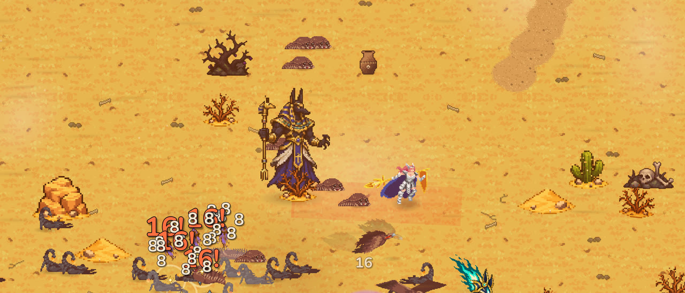

<h1 align="center">Titan Survivors</h1>

  A roguelite horde-survival game for iPhone, iPad and Android. 
  <b>Launching December 11, 2026</b> on the App Store and Google Play.

  <a href="https://www.youtube.com/@titansurvivors">YouTube</a> ·
  <a href="https://www.tiktok.com/@titansurvivors">TikTok</a> ·
  <a href="https://ozkankazan41-droid.github.io/">Website</a>

## The game

Pick a hero, build your weapon from the cards you choose, survive the horde for eight minutes, then bring down the titan of the dungeon.

  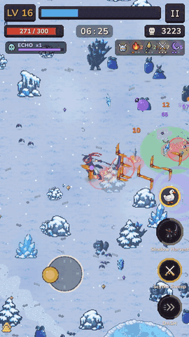
  &nbsp;
  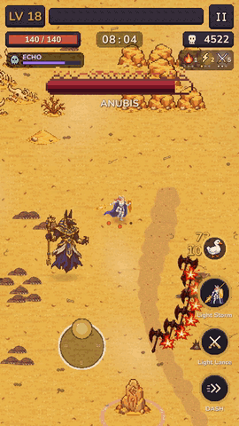

- **7 heroes**, each with a signature attack, a skill and an ultimate
- **9 weapons**, each with its own mechanic, levels and an evolution
- **8 dungeons** with their own enemies, weather and music, and a titan that arrives at 8:00
- **Level-up cards** in several rarities, with rerolls, so no two runs build the same
- **Fates**: optional rules that change a run, such as Glass Cannon
- **Titan Tree**: permanent upgrades for every hero and weapon, with a free reset
- **Collection**: an enemy book with a page for each dungeon
- **Weapon mastery**, daily and weekly quests and a daily gift
- **8 languages**: English, Turkish, Spanish, French, Italian, Dutch, Japanese and Russian
- **No forced ads**: an ad only plays when the player picks one, for a second chance, double gold or free gems

## Screenshots

  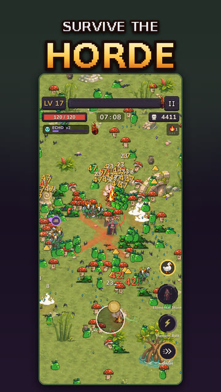
  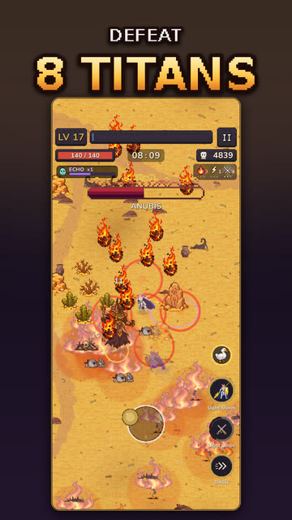
  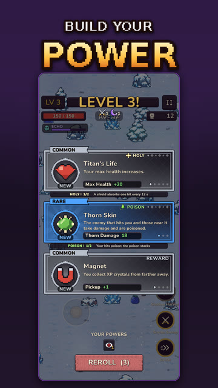
  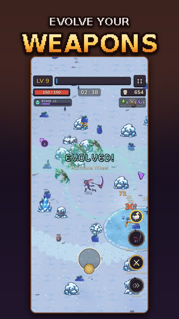

  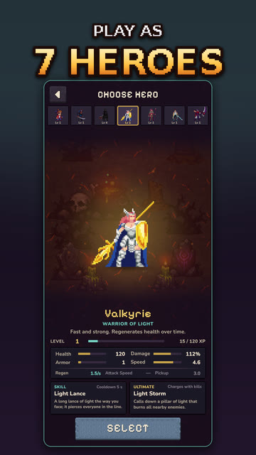
  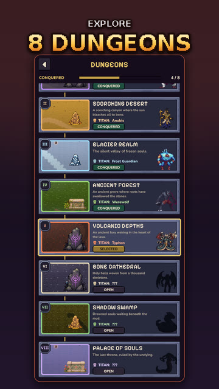
  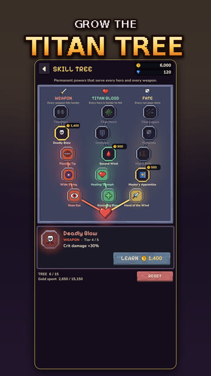
  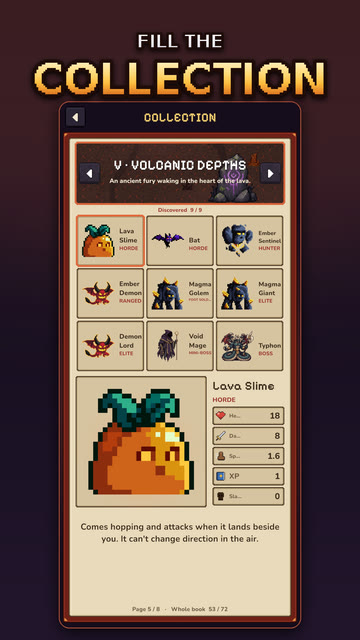

## How it is built

- **Engine:** Unity 6, 2D URP, C#
- **Platforms:** iOS and iPadOS (Xcode, TestFlight) and Android (Google Play)
- **Audio:** boss themes with intros and loops scheduled on the audio clock; dungeon music and ambience generated for the game
- **Tooling:** Unity editor tools that build content, capture store screenshots and run automated bot playthroughs for balancing
- **Ads:** AdMob rewarded ads with Google's consent form

## Who made it

I'm **Özkan Kazan**, a barista in Istanbul who makes games at night. I lead Titan Survivors: the game design, the systems and how they should feel, art direction and asset selection, balance and playtesting, the store pages and the marketing.

The code was written with **Claude**, Anthropic's AI, working in my Unity project under my direction. I decide what gets built, play every build and own the result.

## Status

In closed testing on TestFlight and Google Play. Release: **December 11, 2026**.

This repository is a showcase only. It contains no source code and no game assets.

## Credits

- Hero and boss art: **chierit**, [CC BY 4.0](https://creativecommons.org/licenses/by/4.0/), some frames edited
- Enemy art: **KBPixelArt**, **MonoPixelArt**, **Clembod**, **Kronovi**, **LuizMelo**
- Boss music: **AlkaKrab**
- Fonts: Nunito, Alegreya Sans, Pixelify Sans and M PLUS Rounded 1c, under the SIL Open Font License

Third-party art and audio are used under their own licenses and are not included here.
